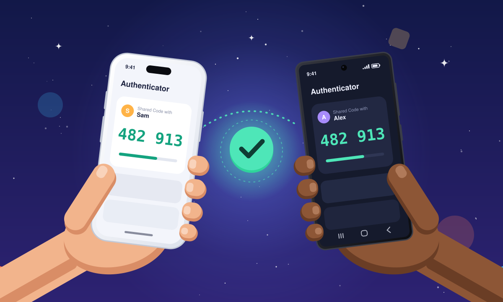

# pair-totp



Set up a shared two-factor (TOTP) code between two people so they can verify each other's identity, for example over the phone.

## Why

AI can now clone a person's voice, or fake their face on a video call, from a short recording. Impersonation scams use this to pose as a family member, friend or colleague who urgently needs money, a password or a favour. "It sounded just like them" is no longer proof.

People need a check that's quick, intuitive, and can't be faked by anyone who only has recordings of you. pair-totp provides one. The two of you set up a shared code once, in person. From then on, either of you can ask "what's our code?" and compare the 6-digit number in your authenticator apps. A cloned voice can't produce it.

## How it works

pair-totp is a single static page.

1. Person A and Person B each enter their name.
2. The page generates a 160-bit secret with `crypto.getRandomValues` and encodes it in Base32.
3. Person A scans a QR code (`otpauth://totp/...`). It appears in their app as **Shared Code with B**, from pair-totp.
4. That QR code is removed, and Person B scans one with the same secret, which appears as **Shared Code with A**.
5. The secret is wiped from the page.

Do this in person. Anyone who sees a QR code can make the same codes, so don't run the wizard over a video call or screen share unless there's no other way, and don't take screenshots of it.

Afterwards both apps show the same 6-digit code, which changes every 30 seconds. Whoever starts a call proves who they are: they read out their current code, and the person they called checks it against their own app.

**Never read your code to someone who called you.** Otherwise, a scammer could call each of you at the same time, pretending to be the other person, and pass one person's code on to the other. If the caller wants to check it's you too, hang up and call them back on the number you already have for them. Then you read your code.

Codes use the standard settings: SHA1, 6 digits, 30-second period. There is deliberately no option for 8 digits or 60-second periods. Not every app honours them, and a mismatch fails silently: the app accepts the code and then shows numbers that never match.

If someone is running the wizard on their own phone, they can't scan their own screen, so they tap the QR code instead. It's a link to the same `otpauth://` URI, which opens their authenticator app. Ente Auth and Google Authenticator both handle these links on Android and iOS. The link is removed along with the QR code.

If a phone can't scan, each QR screen can show the setup key as text with a **Copy** button. Use it only when scanning or tapping isn't possible. The key is cleared from the clipboard when you finish, but iPhones can share the clipboard with the owner's other Apple devices (Universal Clipboard), and some Android keyboards and clipboard apps keep a history of their own.

Names may contain letters (any language), numbers, spaces, hyphens, apostrophes and full stops. Anything else is removed as you type, so a name can't break the `otpauth://` URI or show up garbled in an app.

## Which authenticator app?

Both people need one installed before they start. The intro screen has buttons for Android, iPhone and Other. Each shows a store link plus a QR code you can scan with a phone camera when the page is open on a computer. On a phone or tablet, the page picks the right one automatically.

- **Recommended: [Ente Auth](https://ente.com/auth/)**. It's free and open source (AGPL-3.0), works offline without an account, and offers optional end-to-end-encrypted backups.
  - [Google Play](https://play.google.com/store/apps/details?id=io.ente.auth) · [F-Droid](https://f-droid.org/packages/io.ente.auth/) · [App Store](https://apps.apple.com/app/id6444121398) · [Windows, macOS, Linux, web](https://ente.com/auth/)
- **Last resort: Google Authenticator**. It works, but it isn't open source. Choose "Use without an account" so the code stays on the phone.
  - [Google Play](https://play.google.com/store/apps/details?id=com.google.android.apps.authenticator2) · [App Store](https://apps.apple.com/app/id388497605)

Any other TOTP app works too, for example Aegis, 2FAS, FreeOTP, Bitwarden or 1Password. A desktop app can't scan a QR code shown on its own screen, so use the "Show the setup key" option and its Copy button instead.

## Privacy and security

- **No network requests.** All code is served from this repository, including the QR library. A Content-Security-Policy in `index.html` blocks any connection, font, external script, and any image not served from this site, so the browser itself enforces this. The app store links on the intro screen are plain links that open in a new tab only if you tap them. Their QR codes are drawn locally.
- **No storage.** The secret is never written to localStorage, sessionStorage, IndexedDB, cookies, or the URL.
- **Wiped after use.** Each QR code is cleared from the page when you move past it. On the last screen the secret's bytes are zeroed and every reference to it is dropped. JavaScript can't overwrite strings in memory, so close the tab when you're done to clear it from the browser completely.
- **Pinned files.** `index.html` carries Subresource Integrity hashes for `app.js`, `style.css` and `vendor/qrcode.js`. Every GitHub Pages site under one account shares an origin, so without them the CSP's `'self'` would also trust scripts from the owner's other Pages sites.
- **No HTML injection.** Names are filtered as you type and only ever inserted as text.
- **Not in a frame.** GitHub Pages can't send `X-Frame-Options`, and a CSP set in a meta tag can't use `frame-ancestors`, so `app.js` refuses to run when the page is loaded inside another page's frame. A fake site can't wrap the real page and cover its QR code with its own.
- **Fails closed.** If the browser has no secure random number generator (`crypto.getRandomValues`), the wizard stops instead of creating a weak secret.
- **Airplane mode works.** Every file the page needs, pictures included, loads when you open it, so you can switch to airplane mode before creating the secret.

See [SECURITY.md](SECURITY.md) for what pair-totp does and doesn't protect against, and how to report a problem.

## Verify it yourself

Check that the live site serves exactly the files in this repository:

```bash
git clone https://github.com/RedRoosterKey/pair-totp.git && cd pair-totp
for f in index.html app.js style.css vendor/qrcode.js; do
  curl -s "https://redroosterkey.github.io/pair-totp/$f" | cmp - "$f" && echo "$f matches"
done
```

Check that `vendor/qrcode.js` is the unmodified file from npm. `npm pack` checks the download against the registry's integrity hash:

```bash
mkdir -p /tmp/qrcheck && npm pack qrcode-generator@1.4.4 --pack-destination /tmp/qrcheck
tar -xzf /tmp/qrcheck/qrcode-generator-1.4.4.tgz -C /tmp/qrcheck
cmp /tmp/qrcheck/package/qrcode.js vendor/qrcode.js && echo "vendor/qrcode.js matches npm"
```

Check that the integrity hashes in `index.html` match the files:

```bash
python3 tools/update-sri.py --check
```

In the browser, open the developer tools' Network tab and walk through the wizard: the only requests are this site's own files, all made when the page loads.

## Host it on GitHub Pages

1. Create a new GitHub repository and push these files to the `main` branch:
   ```bash
   git init
   git add .
   git commit -m "pair-totp"
   git branch -M main
   git remote add origin https://github.com/<you>/pair-totp.git
   git push -u origin main
   ```
2. On GitHub, open the repository's **Settings → Pages**.
3. Under **Build and deployment**, set **Source** to **Deploy from a branch**, choose **main** and **/ (root)**, and click **Save**.
4. After a minute or so the site is live at `https://<you>.github.io/pair-totp/`.

The link-preview tags in `index.html` (`og:url`, `og:image`) point at `https://redroosterkey.github.io/pair-totp/`. If you fork this or use a custom domain, change those two URLs, since previews need absolute addresses.

The `.nojekyll` file tells Pages to serve the files as they are, with no Jekyll processing. Pages serves over HTTPS, which `crypto.getRandomValues` and authenticator apps are happy with.

## Run it locally

Any static file server works:

```bash
python3 -m http.server 8000
```

Then open <http://localhost:8000>.

Opening `index.html` directly from disk (a `file://` address) doesn't work: browsers can't check integrity hashes on local files, so they refuse to load the stylesheet and scripts. The page shows up unstyled and the wizard won't start.

After changing `app.js`, `style.css` or `vendor/qrcode.js`, update their integrity hashes, or the browser will refuse to load them:

```bash
python3 tools/update-sri.py
```

## Files

| File                  | Purpose                                                                                                                          |
| --------------------- | -------------------------------------------------------------------------------------------------------------------------------- |
| `index.html`          | The wizard screens, the Content-Security-Policy and integrity hashes                                                             |
| `style.css`           | Layout and light/dark styling                                                                                                    |
| `app.js`              | Secret generation, Base32, `otpauth://` URI, QR drawing, wiping                                                                  |
| `img/hero.svg`        | Intro illustration, generated by `tools/make_hero.py`                                                                            |
| `img/og.png`          | 1200×630 link-preview image, a crop of the same illustration                                                                     |
| `img/step-*.svg`      | Pictures for steps 2–7, generated by `tools/make_steps.py`                                                                       |
| `tools/update-sri.py` | Updates or checks the integrity hashes in `index.html`                                                                           |
| `SECURITY.md`         | Threat model and how to report a problem                                                                                         |
| `vendor/qrcode.js`    | [qrcode-generator](https://github.com/kazuhikoarase/qrcode-generator) 1.4.4 by Kazuhiko Arase, MIT licensed, vendored unmodified |

The vendored library's SHA-256 is `18ae399f81182bc9de916e9c77b195df20cc58d6f2d55a62b085a299f1bf1780`, matching `qrcode-generator@1.4.4/qrcode.js` on npm. Its license is in `vendor/LICENSE-qrcode-generator.txt`.

## License

MIT. See `LICENSE`.
